# SloshBot-RL

**Balancing, trajectory tracking and liquid transport on rough terrain**

## 1. Overview

SloshBot-RL investigates a liquid-carrying BallBot: a mobile inverted pendulum that must balance, follow a figure-eight reference and limit liquid motion while traversing uneven ground. Wheel–ball contact, changing ground normals, actuator limits and liquid reactions interact; staying upright alone does not establish successful trajectory tracking.

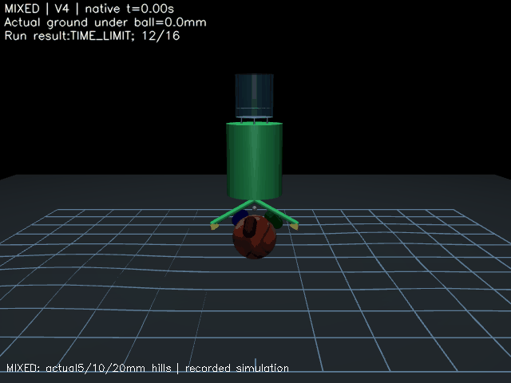

*Actual recorded MuJoCo states, replayed for visualization. Collision geometry contains separate smooth 5, 10 and 20 mm hills. The visible liquid surface is reconstructed from the two-mode ROM, not CFD.*

**Current result:** V4 and frozen residual PPO complete all 24 new 30 s height-study runs within the checked physical guards. Tracking worsens with terrain height; **none passes the complete registered figure-eight task**. PPO differences are too small to establish superiority. Liquid status remains **SPH_BLOCKED**; there is no hardware validation.

## 2. Key Research Contributions

This repository integrates established modeling/control methods into an auditable research workflow; it does not claim to invent MuJoCo, linear sloshing theory, PID, pole placement, PPO or Gaussian mixtures.

- **Coupled BallBot–liquid simulation:** native multibody reactions from a mass-accounted, passive two-coordinate liquid ROM.
- **Rough-terrain contact simulation:** collision heightfields, contact diagnostics, and progressive 5/10/20 mm smooth-hill evaluations.
- **Slosh-aware control:** project-specific V4 centroid/modal feedback on the existing tracking cascade, with explicit privileged-information disclosure.
- **Model-based teacher exploration:** historical preview/receding-horizon studies, including feasibility and tracking–energy trade-offs; not a verified enlarged-task baseline.
- **Residual PPO:** a bounded learned correction on V4, trained using eight parallel environments for one shared policy.
- **Gaussian Mixture PPO experiments:** historical fixed seven-component action exploration with marginalized likelihoods; no verified comparable enlarged-task checkpoint or general superiority claim.
- **Enlarged figure-eight benchmark:** a 1.50 × 0.75 m, 30 s task with ordered tracking windows, torque, balance and ROM guards.
- **Scientific evaluation and reproducibility:** paired contexts, failure retention, raw trajectories, actual learning logs, SHA-256 manifests and regression tests.

The rigid-body model/assets originate from [OpenBallBot-RL](https://github.com/salehiac/OpenBallBot-RL). Project additions are adapters, liquid modeling/coupling, controller variants, experiment protocols and evidence packaging. See [algorithm scope](docs/ALGORITHMS.md) and [claim/evidence mapping](docs/CLAIM_EVIDENCE.md).

## 3. System Architecture

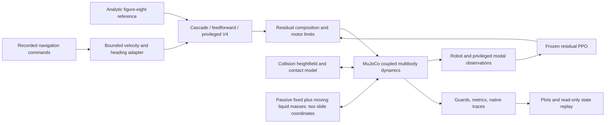

MuJoCo integrates robot, sphere, wheels and liquid coordinates together at 2 ms using RK4. Controllers see a versioned state/reference interface; PPO acts every 10 ms. The renderer does not alter the physical state. Independent Chrono screening is separate and is not represented as validated online SPH coupling. [System model](docs/SYSTEM_MODEL.md).

## 4. Mathematical Modeling

Let $q$ include the rigid-body and two modal coordinates. The implemented native multibody system is described by

```math
M(q)\ddot q+b(q,\dot q)=B\tau+J(q)^T f_c+f_{\mathrm{passive}}(q,\dot q).
```

Here $b$ includes gravity and velocity-dependent terms; $f_c$ is the native contact/constraint force. This is a description of MuJoCo's assembled equations, not a separately integrated hand-derived BallBot model. Modal springs/dampers enter once through passive joint forces.

For a cylindrical tank, the source uses

```math
h=\frac{V}{\pi R^2},\quad \omega^2=g\frac{\alpha}{R}\tanh\left(\frac{\alpha h}{R}\right),\quad \alpha=1.8411837813406593,
```

```math
m_1=\frac{2mR\tanh(\alpha h/R)}{h\alpha(\alpha^2-1)},\quad k_s=m_1\omega^2,\quad c=2\zeta\omega m_1.
```

The standalone linear translation limit is $\ddot\xi+2\zeta\omega\dot\xi+\omega^2\xi=g_\parallel-a_\parallel$. The deployed native model includes rotational/inertial terms through multibody dynamics; it does not run this standalone equation beside MuJoCo.

```math
E_{\mathrm{modal}} = \frac{1}{2} m_1 \lVert \dot{\xi} \rVert^2
                  + \frac{1}{2} k_s \lVert \xi \rVert^2.
```

```math
p_r(t) = p_0 +
\begin{bmatrix}
0.75 \sin(2\pi t/30) \\
0.375 \sin(4\pi t/30)
\end{bmatrix}
\,\mathrm{m}.
```

The 0.5 L liquid has total mass 0.499 kg: **one** 0.338885 kg moving body with two slides plus 0.160115 kg fixed mass. Frequency is 2.128736 Hz; damping ratio 0.02 is assumed. Native reactions provide two-way coupling; diagnostic force/torque is not reapplied. The modal-height approximation limits pressure-moment fidelity. [Equations, units and source links](docs/SYSTEM_MODEL.md).

## 5. Control Algorithms

| Method | Implemented role | Comparable enlarged-task evidence |
|---|---|---|
| PID | Inherited attitude balancing | No equivalent XY/yaw task contract; not evaluated here |
| Cascade V2 / V3 | Position outer loop, constrained tilt inner loop; V3 modifies inner rate gain | Three matched trials each; early tracking failures |
| V2_FFv1 | Analytic reference velocity/acceleration feedforward | Three trials; ROM failures at 20.42–23.54 s |
| V3_FFv1 | Feedforward on V3 | Three 30 s runs, but approximately 85–89° yaw drift |
| Slosh-aware V4 | Identified centroid/modal feedback on V2_FFv1 | Three 30 s runs; 15/16 windows; privileged |
| Model-based teacher | Historical model-based preview/receding-horizon exploration | No frozen equivalent enlarged-task release comparison |
| Standard PPO | Learned bounded residual on V4 | Three 30 s runs, same 15/16; privileged |
| Gaussian Mixture PPO | Historical structured action-distribution pilot | Not evaluated in this enlarged-task comparison |

V4 and PPO are directly compared over complete matched horizons. V3_FFv1 has complete traces but fails the yaw gate. Early-terminated baselines retain their failed prefixes; their energy cannot be ranked against 30 s survivors as an algorithm-only improvement. Information privileges and controller/reference interfaces differ. [Detailed algorithms](docs/ALGORITHMS.md).

## 6. Reinforcement Learning Framework

The released checkpoint is a Standard PPO actor–critic: separate **64–64 Tanh MLPs**, **31 privileged observations**, and **three diagonal-Gaussian residual actions**. Inputs include robot/reference state, previous action, base control, heading, liquid position/velocity, analytic acceleration and reference phase. Inputs are scaled and clipped to ±10; no CNN or learned image encoder is used.

The residual is composed in three stages, with clipping applied component-wise:

```math
\delta = 0.25\,\mathrm{clip}(a,-1,1).
```

```math
u_r = \mathrm{clip}(u_{\mathrm{V4}} + \delta,-1,1).
```

```math
\tau = -10\,\mathrm{clip}(u_{\mathrm{base}} + 0.03u_r,-1,1).
```

Here, `clip(x, -1, 1)` limits each component of `x` to the interval `[-1, 1]`; motor torque is in N·m.

Thus a raw action is not a direct motor torque. The reward is time-integrated `exp(-C)`, where `C` weights normalized position, velocity, tilt, modal energy, torque and residual variation; invalid termination receives −5. The PPO update uses GAE with discount factor γ = 0.99, GAE parameter λ = 0.95, ratio clipping 0.2 and target KL 0.03.

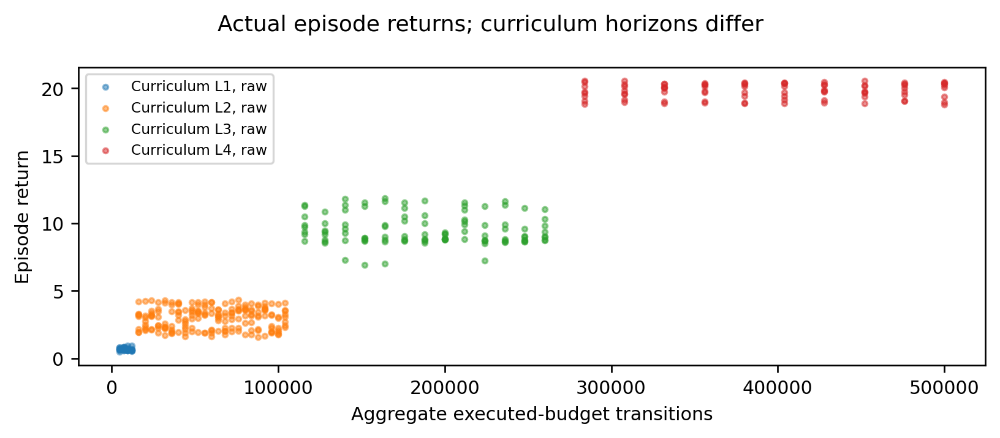
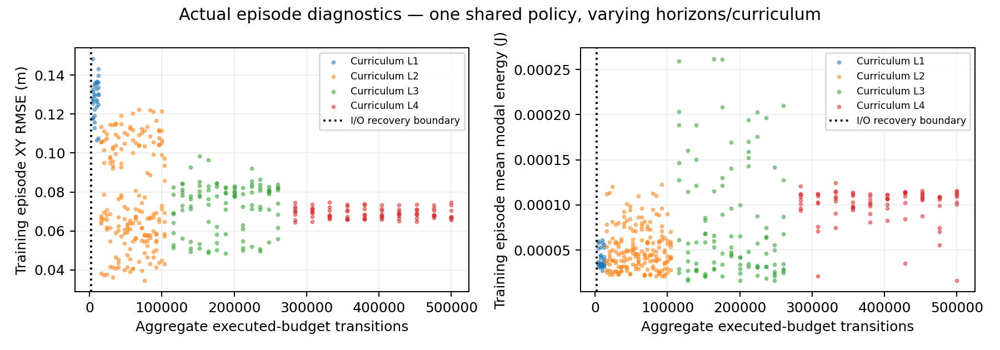

**Accounting:** 500,000 executed policy transitions, **497,600 optimization transitions**, 124 buffers and one independent training seed (2611001). Eight workers are **not eight independent replications**. The checkpoint's internal timestep is 499,992. An I/O failure discarded 2,400 pre-update transitions; recovery reset workers and was not exact continuation. Selection used two development contexts before three held-out contexts, not final outcomes. This documentation update performs no training. [RL details and raw logs](docs/REINFORCEMENT_LEARNING.md), [checkpoint provenance](docs/PPO_PROVENANCE.md).

## 7. Experimental Setup

**Experiment 1 — Autonomous Figure-Eight Trajectory Tracking.** The 1.50 × 0.75 m bounding box uses amplitudes 0.75/0.375 m, period/horizon 30 s, 2 ms native steps and 10 ms policy actions. Six frozen methods × three paired contexts produce 18 trials, including stopped failures. The task requires all 16 temporal tracking windows, XY RMSE ≤100 mm, peak error ≤250 mm, path length ≥70% of reference, balance/yaw/torque/ROM gates and full duration. The robot starts at rest while reference velocity is initially nonzero; startup error is included.

**Experiment 2 — Rough-Terrain Balance and Navigation Stability.** Recorded bounded velocity/yaw requests drive a closed-loop command adapter across fixed collision heightfields; a keyboard is one possible request source, not the scientific contribution. Eighteen registered 26 s routes (six terrain conditions × three contexts) test ordered approach, corridor crossing, post-feature progress, ≥0.5 m displacement and physical validity. Route completion and velocity/yaw quality are reported separately.

**Terrain-difficulty extension.** An additional 24 paired 30 s figure-eight runs compare frozen V4/PPO on 5, 10 and 20 mm hills plus mixed heights. H05/H10/H20 share the same footprint; the older 2 mm roughness has a different shape and is not an amplitude-only control. Three reset seeds per controller/terrain are contexts, not independent training seeds. [Protocols and exact gates](docs/EXPERIMENTS.md).

## 8. Experimental Results and Controller Comparison

### Enlarged figure-eight: survival does not equal task completion

| Method | n | Mean observed duration (s) | XY RMSE (mm) | Ordered windows | Full task |
|---|---:|---:|---:|---|---:|
| V2 | 3 | 1.39 | 158.84 | 0,0,0 | 0/3 |
| V3 | 3 | 1.39 | 157.27 | 0,0,0 | 0/3 |
| V2_FFv1 | 3 | 21.88 | 68.66 | 11,10,12 | 0/3 |
| V3_FFv1 | 3 | 30.00 | 67.50 | 15,15,15 | 0/3 |
| V4 | 3 | 30.00 | 68.08 | 15,15,15 | 0/3 |
| PPO | 3 | 30.00 | 68.04 | 15,15,15 | 0/3 |


Values are means across three contexts; failed methods use their observed prefix. V4/PPO tracking RMSE is 68.08/68.04 mm, mean modal energy approximately 0.0001021/0.0001020 J, and torque RMS 2.7970/2.7968 Nm. These tiny differences do not support a PPO superiority claim. V3_FFv1's seemingly competitive tracking is invalidated by excessive yaw drift.

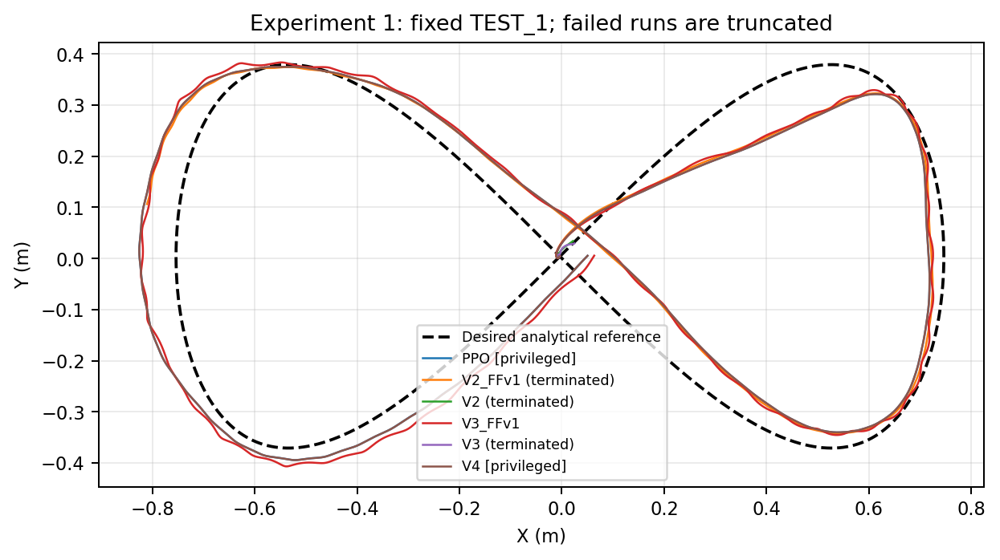
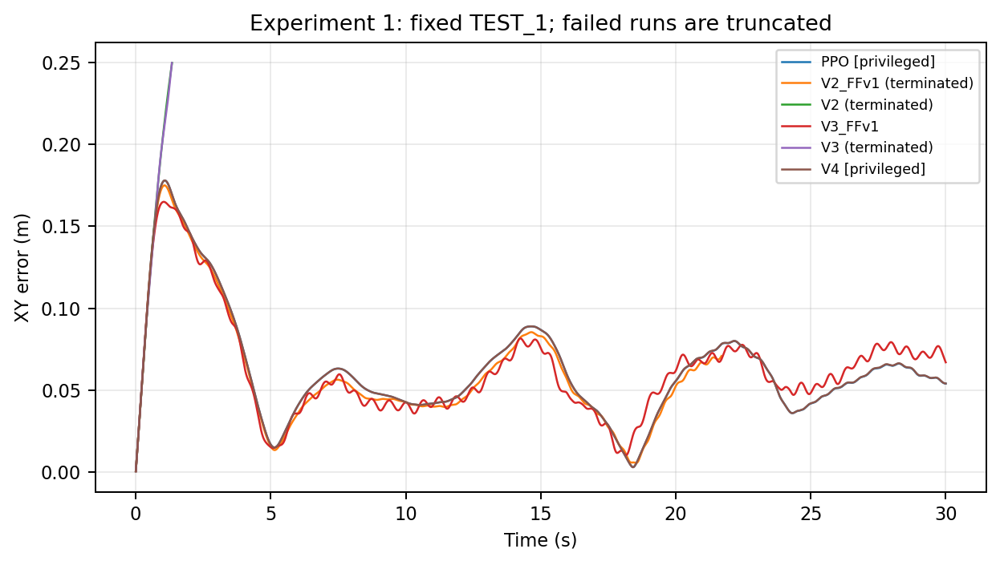
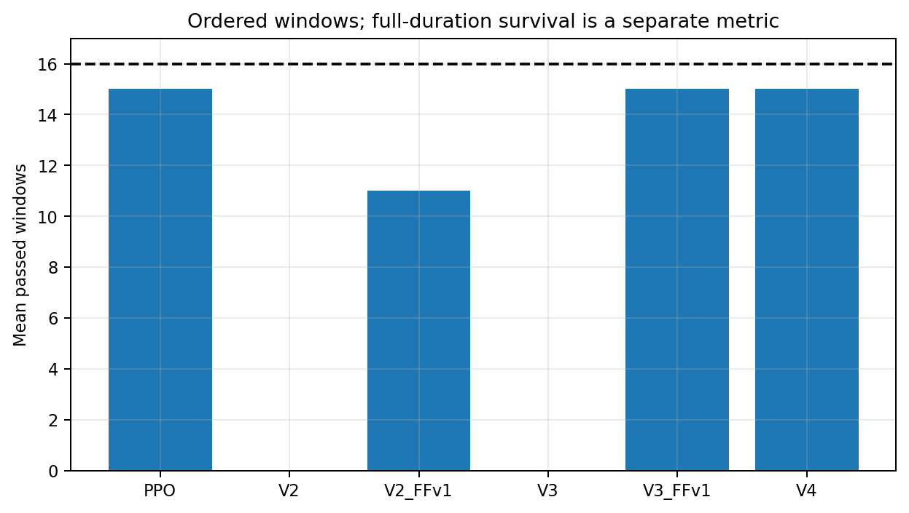

### Liquid motion, balance and effort

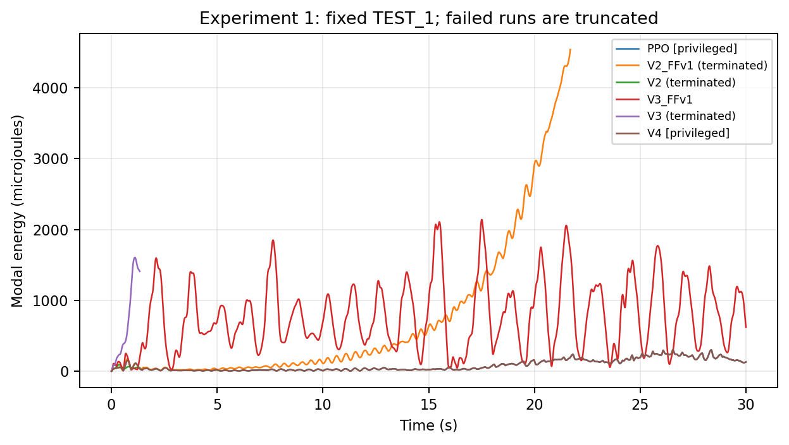
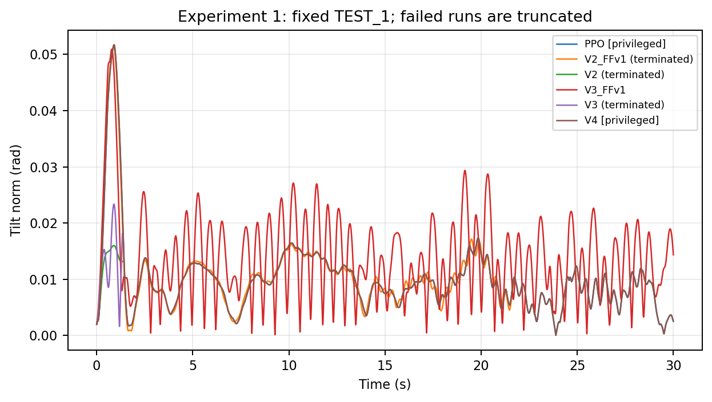
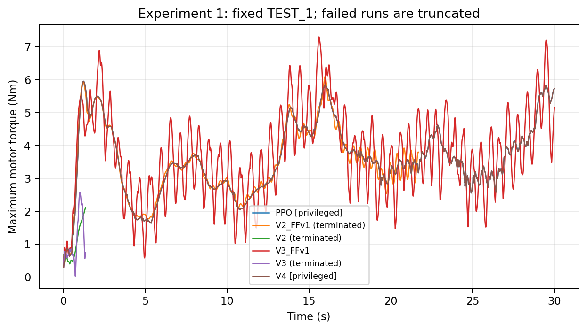

Feedforward alone encounters the 8.4 mm ROM bound in all V2_FFv1 runs. V4 suppresses the growing modal response sufficiently to preserve the tested horizon, but this is evidence within the ROM, not independent fluid validation. The V4/PPO full-horizon traces remain below motor limits; navigation routes can approach saturation and therefore have less headroom.

### Terrain height: 24 full-duration paired runs

| Terrain | V4 RMSE (mm) | PPO RMSE (mm) | Ordered windows, each controller | Full task |
|---|---:|---:|---|---:|
| 5 mm | 71.80 | 71.77 | 15, 15, 15/16 | 0/6 |
| 10 mm | 81.35 | 81.32 | 14, 14, 14/16 | 0/6 |
| 20 mm | 113.87 | 113.85 | 10, 11, 11/16 | 0/6 |
| Mixed 5–20 mm | 100.07 | 100.03 | 12, 12, 12/16 | 0/6 |


Each RMSE is the mean of **three 30 s episodes**. All 24 runs complete 30 s within checked physical guards; **0/24 pass the full task**. Sampled terrain peaks are 4.987, 9.974 and 19.948 mm, with maximum slopes approximately 0.85°, 1.70° and 3.40°. The ball-centre lift reaches approximately 19.7 mm after initial contact settlement on H20: the terrain is actual collision geometry, not scenery.

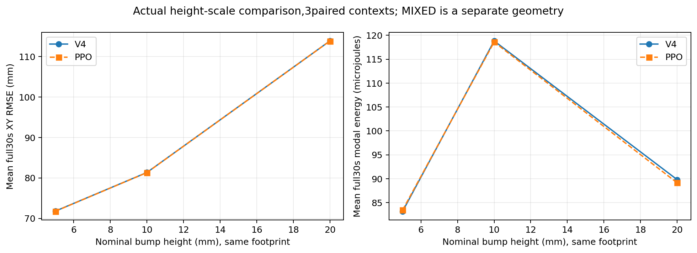
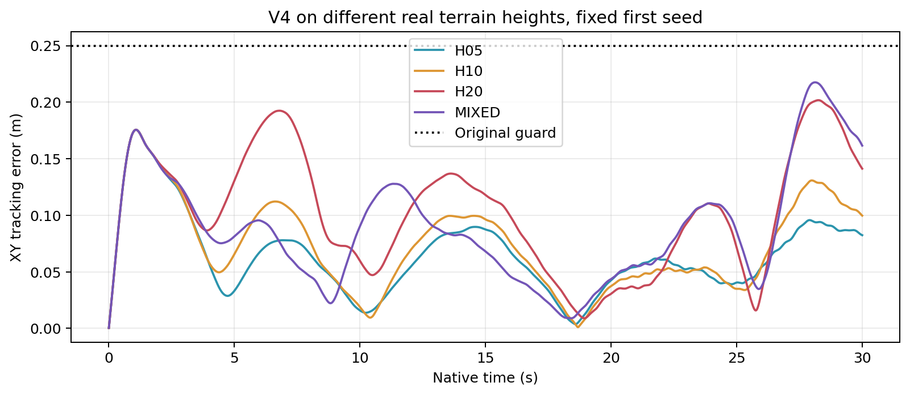
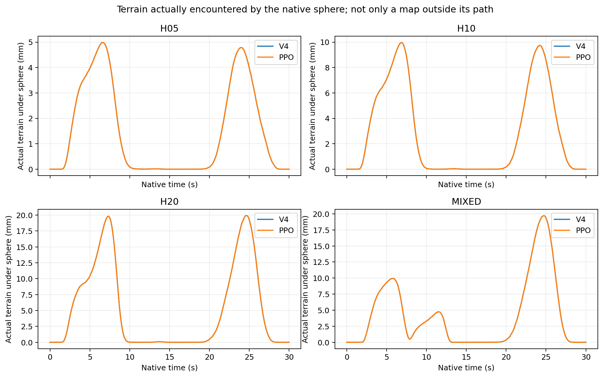

PPO reduces mean RMSE by only roughly 0.025–0.038 mm relative to V4. There is no independent policy-seed evidence or new timestep-convergence analysis sufficient to interpret this as robust improvement. H20 exceeds the 100 mm RMSE gate; even H05 misses one ordered window.

### Recorded-command navigation and failures

The 18 registered routes complete geometrically in **17/18** cases: FLAT, MILD, RANDOM, BUMPS and SLOPES each 3/3; COURSE 2/3. COURSE seed 2618001 stops at a ROM guard around 19.57 s. Applying the separately retained velocity/yaw-quality criteria gives **15/18**, not 17/18. Some navigation trials spend up to 39.4% of samples near motor saturation; do not transfer their route success to the figure-eight torque-quality gate.

[Raw baseline CSV](experiments/experiment_1_figure8/comparison.csv) · [Raw height CSV](research/terrain_heights/comparison.csv) · [Traversal CSV](upgrade/results/traversal.csv) · [Detailed results and failure cases](docs/RESULTS.md) · [Native comparison GIF](research/terrain_heights/media/height_comparison.gif)

## 9. Discussion

Higher hills change ground normals and required acceleration; the frozen controller loses tracking accuracy even when balance and ROM guards remain satisfied. H05/H10/H20 show increasing mean RMSE, while modal energy is not monotonic. Tracking and slosh suppression are distinct objectives.

The identified model-based V4 feedback provides an interpretable mechanism for reducing the growing coupled mode. It relies on privileged modal/controller states and local identification, so it is not a global stability proof or an immediately deployable hardware controller. PPO's bounded residual retains that strong backbone, but one training seed and very small observed differences leave its added value unresolved.

The complete task remains unresolved: V4/PPO reach 15/16 windows on the inherited benchmark, 14 on H10, 10–11 on H20 and 12 on MIXED. An acceptable aggregate RMSE or upright finish cannot replace ordered window completion. Contact compliance (~5.4–5.6 mm penetration in the inherited audit), finite timestep, assumed damping and modal-height approximation limit physical interpretation.

## 10. Quick Start Guide

### Installation

```bash
python3.10 -m venv .venv
source .venv/bin/activate
python -m pip install -r requirements.txt
python -m pip install --no-deps --no-build-isolation -e .
python -B scripts/doctor.py
```

Pinned dependencies target Python 3.10 and MuJoCo 3.3.2. A C compiler builds local observer/contact plugins. The existing installed environment was tested; a fresh OS installation was not. No CUDA is needed for the released CPU inference demos.

### Autonomous Figure-Eight Demo

```bash
python -B demo_figure8.py --controller V4 --duration 30 --output runs/my_new_figure8
```

This runs closed-loop physics and saves traces; it is not an interactive viewer. Use a fresh output directory. A 20 ms launch smoke was rerun for publication; archived 30 s experiments were not rerun.

### Keyboard Teleoperation

```bash
python -B teleop_keyboard.py --level BUMPS
```

| Key | Request |
|---|---|
| Arrow keys | Forward/reverse/turn |
| Space | Controlled stop request |
| R | Reset |
| Esc | Exit |

A graphical desktop is required. This is interactive simulation, not certified real-time. [Full controls, logging and replay](docs/TELEOPERATION.md).

### PPO Inference

```bash
python -B demo_rl.py --duration 30 --output runs/my_new_ppo
```

Loads the actual frozen [500k checkpoint](pretrained/ppo_500k.zip), uses deterministic CPU inference and performs no optimization. A short smoke verifies loading and native stepping.

### Reproducing Results

```bash
python -B scripts/test_essential.py
python -B scripts/verify_release.py
```

[Detailed reproducibility guide](docs/REPRODUCIBILITY.md) distinguishes artifact verification, bounded regression, replay and new simulation. New runs never overwrite archived results.

## 11. Research Paper

The available [English manuscript source](paper/main.tex) and [manuscript notes](paper/README.md) describe the model/control work and two-experiment revision. It is a working manuscript, predates the new height-study README, and is not peer-reviewed evidence. No compiled PDF is available or linked.

## 12. Limitations and Future Work

- No hardware validation or deployment claim.
- No independent SPH/CFD validation: finer Chrono static screens fail pressure/weight-force gates; dynamic fluid replay remains gated off.
- Linear two-mode ROM omits breaking, splashing, wetting and higher modes; damping is assumed and pressure-moment equivalence is approximate.
- V4/PPO use privileged information; comparisons are not sensor-matched algorithm-only ablations.
- Full figure-eight completion is unsuccessful under the registered criteria.
- One independent seed for the released 500k PPO lineage; worker/reset seeds do not establish training reproducibility.
- Tiny PPO differences lack independent training-seed and numerical-resolution evidence.
- Terrain features are smooth hills, not vertical steps; contact compliance limits hardware inference.

Priorities are contact/physical validation, full-task tracking and properly powered controller comparisons before additional RL or hardware claims. This publication does not launch a new research phase.

## 13. Citation and Acknowledgments

No project DOI, accepted publication or verified author list is asserted. For now, cite this repository URL with the Git commit used and access date; the [manuscript](paper/main.tex) is source material, not a published citation.

Based on [OpenBallBot-RL](https://github.com/salehiac/OpenBallBot-RL). MuJoCo, Stable-Baselines3, PyTorch, Gymnasium, NumPy and SciPy supply established algorithms/runtime components; Project Chrono is the separately screened high-fidelity candidate. The original [Apache-2.0 LICENSE](LICENSE), [NOTICE](NOTICE), and [Chrono license](research/high_fidelity/CHRONO_LICENSE) are retained. Upstream source/assets remain under `_vendor/` with provenance hashes.
